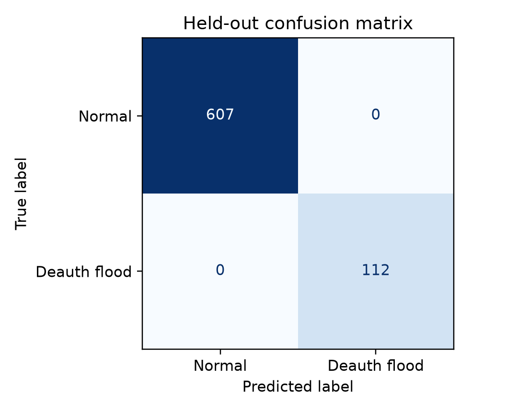
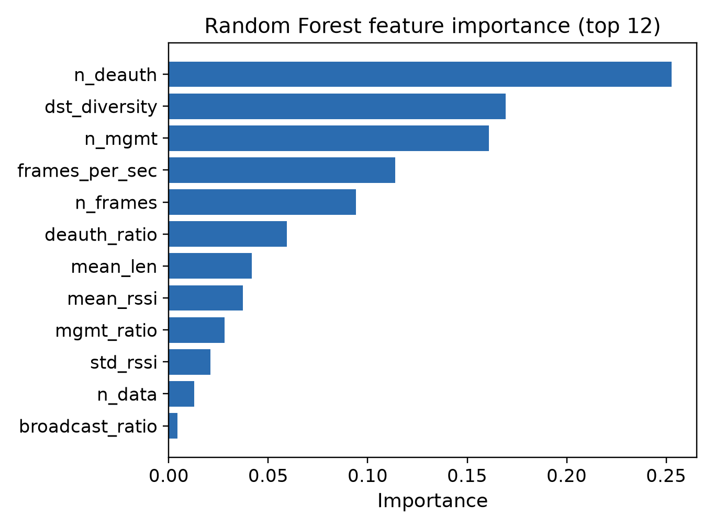

# WIDS: Detecting 802.11 Deauthentication Floods

This is my wireless intrusion detection system (WIDS) prototype. It reads
802.11 captures, builds per-device features for each second, and uses a Random
Forest to flag deauthentication floods. When it finds one, it prints an alert
with the MAC address, time, deauth rate, RSSI and model score.

I only built the detection side. The code does not send frames or block
anything, so it is a WIDS and not a WIPS.

---

## 1. Dataset

I used one capture from the public **WPA3 Attacks Dataset**:

> Halbouni, A., Ong, L.-Y., & Leow, M.-C. (2026). *WPA3 Attacks Dataset*.
> Mendeley Data, V3. DOI: [10.17632/cxx5t5nw7z.3](https://doi.org/10.17632/cxx5t5nw7z.3).
> Licence: CC BY 4.0.

The capture I used is the **Deauthentication attack** capture:

| Item | Value |
|---|---|
| Capture duration | 916 s (15 min 16 s) |
| Frames | 722,606 |
| Normal frames | 515,384 |
| Deauth-labelled frames | 207,222 |
| Deauth flood interval | 370 s (07:34:12 to 07:40:23) |
| Attack sources seen | `02:00:00:00:00:72`, `02:00:00:00:00:cb` |
| Capture | `data/raw/wpa3_deauth.pcap` |
| Labels | `data/raw/wpa3_deauth.csv` (`Label` = Normal / Deauth) |

The dataset authors captured this on an isolated WPA3 testbed. I did not
generate or capture any new traffic for this project.

### Getting the raw data

The raw files are not in the repo because the PCAP and CSV are about 230 MB.
If you want to rebuild the windows, download the Deauthentication attack
capture from the Mendeley page and put `wpa3_deauth.pcap` and
`wpa3_deauth.csv` in `data/raw/`. The prepared windows, trained model and two
demo captures are already included, so you can run training and detection
without the raw files.

---

## 2. How it works

```
PCAP / monitor-mode traffic
        |
        v
tshark field export  ->  1-second windows per transmitter MAC
        |                22 features: frame counts by type/subtype,
        |                deauth/disassoc counts and ratios, frames/s,
        |                mean/std RSSI, unique destinations, broadcast
        |                ratio, retry ratio, reason-code count
        v
Random Forest (300 trees)  ->  P(deauth flood) per MAC/second
        |
        v
Episode aggregation  ->  alert if score >= 0.5, at least 20 deauth/s,
                         and the episode lasts at least 2 s
        |
        v
Console alert + results/alerts.csv
```

A few choices I made:

- **The model does not get the MAC address or timestamp.** It only sees the
  per-second behaviour, so it cannot just memorise a device or a time.
- **I split by time, not randomly.** The first 70% of the attack interval and
  the earlier normal traffic are used for training, and the later traffic is
  held out.
- **I used class weights** because there are more normal windows than attack
  windows.
- **Each row is one MAC in one second**, so an alert can name the MAC that
  caused it.
- **The alert rule needs at least 20 deauth frames/s for at least 2 seconds.**
  That stops short normal deauth exchanges from raising a flood alert.

---

## 3. Results

The test set is 719 windows (607 normal, 112 attack) from later traffic that
the model did not see.

| Metric | Random Forest | Decision Tree |
|---|---:|---:|
| Accuracy | 100.0% | 100.0% |
| Precision | 100.0% | 100.0% |
| Recall | 100.0% | 100.0% |
| F1 | 100.0% | 100.0% |

Confusion matrix (Random Forest), `[[TN, FP], [FN, TP]]`:

```
[[607,   0],
 [  0, 112]]
```

The 100% looks suspicious at first, but the flood is very easy to separate.
The attack sends hundreds to over 1,300 deauth frames per second, while normal
traffic only has short deauth exchanges. It is not leakage: 436 normal windows
still have at least one deauth frame (up to 64/s), and the model still
separates them. The lowest attack score was 0.85 and the highest normal score
was 0.28.





Top features: `n_deauth`, `dst_diversity`, `n_mgmt`, `frames_per_sec`,
`n_frames`, `deauth_ratio`.

### Detection demo

```
$ python detect.py --pcap data/demo_normal.pcap
No deauthentication-flood episodes detected in 316 MAC/windows.

$ python detect.py --pcap data/demo_attack.pcap
2 deauthentication-flood episode(s) detected (threshold=0.50):

[ALERT 1] 2026-02-13 07:34:12 - 07:35:07  MAC 02:00:00:00:00:72
          deauth=215/s  frames=229/s  RSSI=-29 dBm  score=1.00
[ALERT 2] 2026-02-13 07:34:12 - 07:35:07  MAC 02:00:00:00:00:cb
          deauth=1289/s  frames=1298/s  RSSI=-32 dBm  score=1.00
```

On the full 15-minute capture, the detector reports the two sustained flood
episodes:

```
$ python detect.py --pcap data/raw/wpa3_deauth.pcap
2 deauthentication-flood episode(s) detected (threshold=0.50):

[ALERT 1] 2026-02-13 07:34:12 - 07:37:12  MAC 02:00:00:00:00:72
          deauth=218/s  frames=229/s  RSSI=-29 dBm  score=1.00
[ALERT 2] 2026-02-13 07:34:12 - 07:40:23  MAC 02:00:00:00:00:cb
          deauth=1315/s  frames=1319/s  RSSI=-32 dBm  score=1.00
```

Two short low-rate deauth exchanges (3 to 16 frames/s) are also classified as
attack at window level, but the 20 deauth/s minimum suppresses them.

---

## 4. Setup and reproduction

You need Python 3.10 or newer and `tshark` (the Wireshark CLI).

```bash
python3 -m venv .venv
.venv/bin/pip install -r requirements.txt
sudo apt install tshark        # if not already installed
```

To rebuild the window table from the raw capture and labels:

```bash
.venv/bin/python prepare_data.py
```

This writes `data/wpa3_windows.csv`, two 60-second demo captures and
`data/dataset_summary.json`.

To train and evaluate:

```bash
.venv/bin/python train.py
```

Outputs: `models/wids_rf.joblib`, `models/metadata.json`,
`results/metrics.json`, the confusion matrices, the feature importance plot
and `results/test_predictions.csv`.

To run the WIDS:

```bash
.venv/bin/python detect.py --pcap data/demo_normal.pcap   # no alerts
.venv/bin/python detect.py --pcap data/demo_attack.pcap   # alerts
.venv/bin/python detect.py --pcap data/raw/wpa3_deauth.pcap
```

`detect.py` returns exit code 1 when it raises at least one alert, so it is
easy to use in a script.

---

## 5. Limitations

- I only used one capture from one testbed, so the 100% result is optimistic
  and will not generalise to every network.
- The window is one second, so very short bursts may be smoothed out.
- I only model deauthentication floods. Disassociation floods, beacon floods,
  evil twins and higher-layer attacks are not covered.
- MAC addresses can be spoofed, so the source in the alert is only the observed
  source, not proof of who did it.
- Two short low-rate deauth exchanges in the full capture are flagged at window
  level, but the 20 deauth/s rule suppresses them.
- I could not test live monitor mode because the VM I used has no wireless
  adapter. The PCAP replay path works; the scapy live backend is in the code but
  has not been tested on hardware.

## 6. What I would improve

- Test on AWID3 and on captures from other networks.
- Add disassociation floods, beacon floods and evil twin detection.
- Try sliding windows or sub-second windows, and online learning for concept
  drift.
- Test evasion with low-rate, bursty or spoofed-source attacks.
- Add a live dashboard and maybe AP integration. That would be WIPS territory,
  so it is out of scope here.

## 7. AI use

I used OpenCode with a DeepSeek model to help me find and download the dataset,
set up the Python pipeline, debug the tshark extraction and draft the poster
text. I checked the dataset and code, ran the training and evaluation, and
confirmed that the model does not use MAC addresses or timestamps. The numbers
in this README come from the scripts in the repo.

## 8. References

1. Halbouni, Ong & Leow (2026). WPA3 Attacks Dataset. Mendeley Data, V3.
   DOI: 10.17632/cxx5t5nw7z.3. CC BY 4.0.
2. Breiman, L. (2001). Random Forests. *Machine Learning*, 45, 5-32.
3. IEEE 802.11-2020, *Wireless LAN Medium Access Control (MAC) and Physical
   Layer (PHY) Specifications*.

---

## 9. Files

| Path | Contents |
|---|---|
| `features.py` | tshark + scapy feature extraction (per-second, per-MAC) |
| `prepare_data.py` | builds labelled windows and demo captures from the raw WPA3 capture |
| `train.py` | trains/evaluates Random Forest and Decision Tree, writes metrics and figures |
| `detect.py` | WIDS replay runtime: scores windows, groups episodes, prints/logs alerts |
| `data/wpa3_windows.csv` | prepared 2,692-window feature/label/split dataset |
| `data/demo_normal.pcap` | 60 s normal-only excerpt |
| `data/demo_attack.pcap` | 60 s excerpt around the flood start |
| `data/dataset_summary.json` | dataset and split statistics |
| `models/wids_rf.joblib` | trained Random Forest |
| `models/metadata.json` | feature list and model metadata |
| `results/` | metrics, confusion matrices, feature importance, scored windows, alerts |
| `poster/poster.pdf` | ready A1 poster (594 x 841 mm, 1 page) |
| `poster/CANVA_CONTENT.md` | copy/layout pack if rebuilding the poster in Canva |
| `WIDS_Poster_Ted_Kamau.pdf` | submission-named copy of the A1 poster |
| `README.md`, `requirements.txt` | documentation and dependencies |

The raw WPA3 captures (about 230 MB) are not included. Download them from the
dataset DOI and put them in `data/raw/` if you want to run `prepare_data.py`.

## 10. Poster

The A1 poster is built from `poster/poster.tex` with LaTeX. It uses A1 paper
(594 x 841 mm), three columns, a TikZ diagram for the architecture, and the
confusion matrix and feature importance PNGs from `results/`. To rebuild it:

```bash
cd poster
pdflatex poster.tex
cp poster.pdf ../WIDS_Poster_Ted_Kamau.pdf
```

`poster/CANVA_CONTENT.md` has the same text and layout notes if you want to
rebuild it in Canva.
